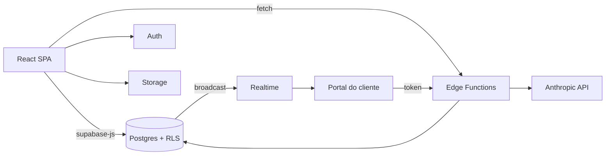

# Quadra Arquitetura


## Sobre o projeto

Sistema operacional da Quadra Arquitetura, escritório de arquitetura e interiores de Belo Horizonte. Reúne gestão comercial, obras, financeiro, tarefas e conteúdo em um único aplicativo web (PWA).

É uma aplicação React de página única que fala direto com o Supabase (autenticação, Postgres, Storage, Realtime) e usa 16 Edge Functions (Deno) para tarefas com segredo, administração de usuários, portal do cliente e recursos de IA (Anthropic). Não há servidor próprio.

Tem quatro frentes: o site público com blog editável, o sistema interno da equipe (login), o portal público do cliente (`/client/:token`) e uma entrada enxuta para as sócias publicarem no site (`/admin`).

**Links**

- Lovable: https://lovable.dev/projects/bb62f3cc-01c8-4342-80c8-67a725b43124
- App: https://quadrarquitetura.lovable.app
- Repo canônico: https://github.com/IAplicada-Business/quadrarquitetura-7d217bf3
- Repo legado: https://github.com/IAplicada-Business/quadrarquitetura

## Funcionalidades

- **Análises:** Dashboard Comercial (funil, conversão, origens), Dashboard Obras (inclui visão multi-obras) e Dashboard Financeiro (receita, despesa, DRE, projeção).
- **Comercial:** Leads em pipeline (kanban), Parceiros e indicações, Clientes, Propostas com PDF por blocos configuráveis e Contratos. Fechar um lead cria cliente e obra.
- **Obras:** Escopo, Orçamentos e cotações, Materiais, Cronograma reverso em dias úteis (calendário brasileiro, caminho crítico, Gantt), Checklist de entrega, Prestação de Contas, Acompanhamento com diário, relatório semanal e Documentos.
- **Portal do cliente:** link por token com trilha da obra, pendências, galeria, orçamento e cenários, cronograma, compras e onboarding, com atualização em tempo real.
- **Tarefas:** Kanban Projetos, Kanban Quadra e Audio Tasks (voz para tarefas).
- **Conteúdo:** Calendário, Roteiros, Publicações e Instagram, com assistente de IA.
- **Site e blog:** landing editável e blog "Obra sem Surto".
- **IA:** chat com contexto do negócio, geração de escopo e atividades, leitura de plantas, memorial descritivo, busca de preços.
- **Admin:** Configurações, Usuários com permissão por tela, notificações e quadro Buddy (bugs e melhorias).

## Tecnologias utilizadas

### Linguagem

| Ícone | Nome | Função |
|---|---|---|
|  | TypeScript | Código do front end e testes |
|  | TypeScript no Deno | Edge Functions em `supabase/functions/` |
|  | SQL (PostgreSQL) | Migrations, RLS, triggers e funções |

### Frontend

| Ícone | Nome | Função |
|---|---|---|
|  | React 18 | Interface |
|  | Vite 5 | Servidor de desenvolvimento e build |
|  | Tailwind CSS 3 | Estilos e tokens de marca |
|  | shadcn/ui | Componentes de base |
|  | Radix UI | Primitivas acessíveis |
|  | React Router 6 | Rotas |
|  | TanStack Query 5 | Cache de dados do servidor |
|  | Framer Motion | Animações da landing |
|  | Recharts | Gráficos dos dashboards |
|  | jsPDF, html2canvas, xlsx | PDF de propostas e relatórios, planilha de NF |
|  | vite-plugin-pwa | App instalável (PWA) |

### Backend

| Ícone | Nome | Função |
|---|---|---|
|  | Supabase (supabase-js 2) | Auth, Storage, Realtime e Edge Functions |
|  | Deno | Runtime das Edge Functions |
|  | Anthropic API (`@anthropic-ai/sdk`) | Recursos de IA nas Edge Functions |

### Banco de dados

| Ícone | Nome | Função |
|---|---|---|
|  | PostgreSQL (Supabase) | Dados, RLS por time, triggers e RPCs |

### Infraestrutura

| Ícone | Nome | Função |
|---|---|---|
|  | Lovable | Editor, publicação e domínio |
|  | Supabase | Projeto de backend gerenciado |

Não há workflow de CI no repositório.

### Testes

| Ícone | Nome | Função |
|---|---|---|
|  | Vitest 3 | Testes unitários e de componentes |
|  | Testing Library | Testes de componentes React |

### Ferramentas

| Ícone | Nome | Função |
|---|---|---|
|  | ESLint 9 | Lint |
|  | PostCSS, Autoprefixer | Pipeline de CSS |
|  | npm | Gerenciador de pacotes (há também `bun.lock`) |

## Arquitetura

O navegador usa o Supabase diretamente. A segurança de dados fica em RLS (visibilidade por time) e em triggers. Edge Functions cobrem o que precisa de segredo ou de service role: IA, criação e remoção de usuários, e o portal do cliente. Regras de cálculo (calendário, funil, finanças, visões do portal) são funções puras em `src/lib/`.



Detalhes em [docs/architecture.md](docs/architecture.md).

## Estrutura do projeto

```text
.
├── src/
│   ├── App.tsx               rotas e área protegida
│   ├── pages/                uma página por rota
│   ├── components/           componentes por domínio (ui/ = shadcn)
│   ├── hooks/                acesso a dados (TanStack Query)
│   ├── lib/                  regras de negócio puras
│   ├── contexts/             AuthContext
│   ├── integrations/supabase cliente e tipos gerados
│   ├── data/                 cláusulas padrão de contrato
│   ├── assets/               imagens da marca
│   └── test/                 testes (Vitest)
├── supabase/
│   ├── functions/            16 Edge Functions (Deno)
│   ├── migrations/           126 migrations SQL
│   └── config.toml           project_id e verify_jwt
├── public/                   ícones PWA, favicon, imagens do Buddy
├── docs/                     documentação técnica (inglês)
├── vite.config.ts            Vite, PWA
├── vitest.config.ts          testes
├── tailwind.config.ts        tokens e tema
└── package.json
```

## Pré-requisitos

- Node.js com npm (a verificação foi feita com Node 22.15; o `package.json` não define `engines`).
- Um projeto Supabase e as variáveis de ambiente abaixo.

## Instalação e execução local

```sh
git clone https://github.com/IAplicada-Business/quadrarquitetura-7d217bf3.git
cd quadrarquitetura-7d217bf3
npm i
npm run dev
```

O servidor sobe em `http://localhost:8080`. Outros scripts: `npm run build`, `npm run build:dev`, `npm run preview`, `npm run lint`, `npm test`, `npm run test:watch`.

Com o Lovable, abra o projeto e faça prompts; os commits vão para este repositório.

## Variáveis de ambiente

Apenas nomes. Veja [docs/configuration.md](docs/configuration.md).

| Nome | Para quê | Obrigatória |
|---|---|---|
| `VITE_SUPABASE_URL` | URL do projeto Supabase | Sim |
| `VITE_SUPABASE_PUBLISHABLE_KEY` | Chave pública (anon) | Sim |
| `VITE_SUPABASE_PROJECT_ID` | Id do projeto (presente no `.env`, sem uso no código) | Não |
| `VITE_PUBLIC_APP_URL` | Domínio público para montar links do portal | Não |
| `VITE_SITE_TEAM_ID` | Time dono do conteúdo do site público | Não |

Segredos das Edge Functions (configurados no Supabase, nunca no repositório): `ANTHROPIC_API_KEY`, `SUPABASE_SERVICE_ROLE_KEY` e, só para a função de migração de arquivos, `MIGRATION_SECRET`, `MIGRATION_TARGET_URL`, `MIGRATION_TARGET_SERVICE_KEY`.

## Testes

```sh
npm test
```

Em 08/11/2026: 75 arquivos e 702 testes passando. A cobertura está nas regras puras de `src/lib/` e em vários componentes; Edge Functions, SQL e permissões não têm testes. Veja [docs/testing.md](docs/testing.md).

## Build e deploy

- `npm run build` gera `dist/`.
- A publicação e o domínio customizado são feitos no Lovable (Share, Publish; Settings, Domains). Docs: https://docs.lovable.dev/features/custom-domain
- Migrations e Edge Functions ficam em `supabase/`. O caminho até a produção não está automatizado no repositório; aplique com critério.

## Documentação

A documentação técnica está em [docs/README.md](docs/README.md). Ela é escrita em inglês para servir a assistentes de IA e a quem contribui. O guia de vídeos do onboarding (`docs/onboarding-videos.md`) continua em português.

## Como contribuir

Leia [CONTRIBUTING.md](CONTRIBUTING.md) e [docs/CONTRIBUTING-DOCS.md](docs/CONTRIBUTING-DOCS.md). Mudanças de comportamento devem atualizar a documentação na mesma alteração.

## Licença

Nenhum arquivo de licença foi encontrado no repositório.
