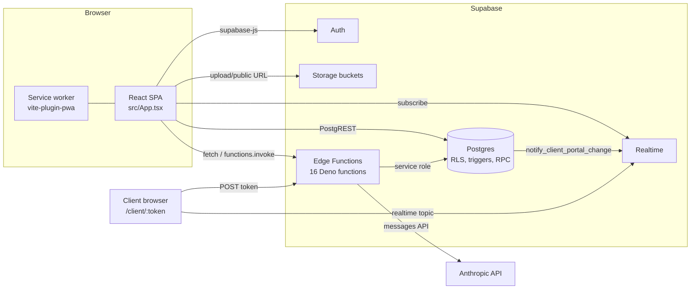
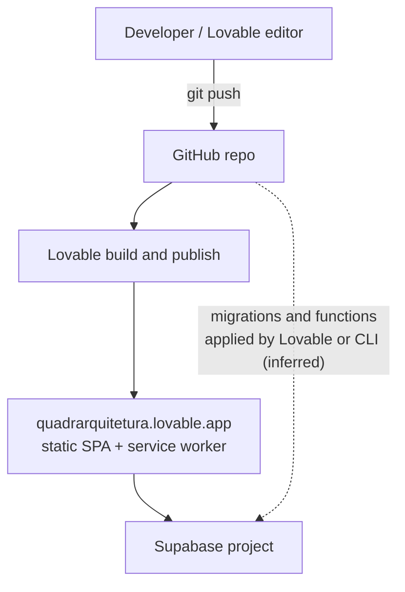

# Architecture

Last verified: 2026-11-13, commit d629e0b (branch feat/sync-5s-aprovacao-cenarios-cliente) plus uncommitted working tree.

## Overview

Quadra is a single-page React app (Vite, TypeScript) that talks directly to Supabase. There is no custom API server. The browser uses `@supabase/supabase-js` for Auth, Postgres (through PostgREST), Storage and Realtime. Server-side logic runs as Supabase Edge Functions (Deno) and as Postgres triggers and functions. Access control is mostly Row Level Security (RLS) in Postgres, plus a screen-permission layer in the front end.

## Layers

| Layer | Location | Responsibility |
|---|---|---|
| Pages | `src/pages/` | One file per route. Compose hooks and components. |
| Components | `src/components/` | Feature components by domain, plus shadcn primitives in `src/components/ui/`. |
| Hooks | `src/hooks/` | Data access (TanStack Query over supabase-js) and mutations per entity. |
| Domain logic | `src/lib/` | Pure functions: calendars, funnel, finance helpers, portal views, PDF builders. No React. Mostly no Supabase. |
| Integration | `src/integrations/supabase/` | Client creation and generated types. |
| Edge functions | `supabase/functions/` | AI calls, admin user management, client portal read/write, notification sweep. |
| Database | `supabase/migrations/` | Schema, RLS, triggers, functions, buckets. |

Pure logic in `src/lib/` is the most tested layer (see [testing.md](testing.md)).

## Communication patterns

| Pattern | Used for | Where |
|---|---|---|
| PostgREST via supabase-js | CRUD on all entities | `src/hooks/*.ts`, some pages |
| TanStack Query cache | Server state, invalidation after mutations | `src/App.tsx` (`QueryClient`: `staleTime` 5 min, `gcTime` 10 min, no refetch on focus) |
| `supabase.functions.invoke` | Authenticated calls to edge functions | `src/components/projects/GenerateActivitiesDialog.tsx`, `src/pages/AdminUsersPage.tsx`, others |
| Raw `fetch` to `/functions/v1/<name>` | Streaming (chat) and calls that need custom headers | `src/hooks/useAIChat.ts`, `src/hooks/useLivePortalData.ts`, `src/pages/ClientPortal.tsx` |
| Realtime `postgres_changes` | Notification bell | `src/hooks/useNotifications.ts` |
| Realtime `postgres_changes` (project tables) | Staff app stays in sync across devices within 5 s (cache invalidation) | `src/hooks/useRealtimeInvalidation.ts`, `src/lib/queryDefaults.ts` |
| Realtime broadcast on topic `portal:<token>` (event `portal_changed`) | Live client portal refresh | `src/hooks/useLivePortalData.ts` (`portalChannelTopic`), SQL `notify_client_portal_change` |
| SSE-like stream | AI chat answer | `supabase/functions/chat-assistant/index.ts` to `src/hooks/useAIChat.ts` |
| `localStorage` | Sidebar state, theme, onboarding seen flag, reminder snooze | `src/components/layout/AppLayout.tsx`, `src/lib/oportunidades-aprovacao-reminder.ts` |

## Data flow (typical staff action)

1. A page calls a hook (`useLeads`, `useProjectActivities`...).
2. The hook runs a query or mutation with the anon (publishable) key and the user JWT.
3. Postgres applies RLS. Most tables filter by `user_id IN (SELECT get_team_user_ids())`.
4. On success the hook invalidates query keys and shows a toast.
5. Triggers may write side effects (history rows, notifications, realtime pings).

See [logic-flows.md](logic-flows.md) for the multi-step flows.

## Multi-tenancy model

Users belong to a team through `team_members`. `get_team_user_ids()` returns all user ids in the caller's team. Rows carry the creator `user_id`, and team members see each other's rows. Admin status comes from `user_roles` (`has_role`). See [business-rules/access.md](business-rules/access.md).

## Integrations

| Integration | How | Notes |
|---|---|---|
| Anthropic API | Edge functions import `npm:@anthropic-ai/sdk`. Model id `claude-opus-5-5` in all AI functions. | Secret `ANTHROPIC_API_KEY`. `search-prices-bh` also uses the `web_search_20260209` tool. |
| Google Fonts | CSS `@import` and `<link>` | Cached by the service worker (`vite.config.ts`). |
| WhatsApp | Deep links `https://wa.me/...` built in the browser | `src/lib/portalUrl.ts`, `src/lib/weeklyReport.ts`, `src/lib/portal.ts`. No API calls. |
| PDF and spreadsheet | `jspdf`, `html2canvas`, `xlsx` in the browser | `src/lib/generateProposalPdf.ts`, `src/lib/generateContractPdf.ts`, `src/lib/generateWeeklyReportPdf.ts`, `src/lib/nfExport.ts` |
| Lovable | Hosting, editor, `lovable-tagger` dev plugin | See Deployment. |
| IAplicada "Buddy" CRM | Table `iaplicada_links` read by `src/components/buddy/DocsProjetoMenu.tsx`; "Buddy bug" board at `/buddy/bug` | The CRM that fills `iaplicada_links` is outside this repo. |

## Deployment topology

- Front end: built by `vite build` into `dist/`. Published through Lovable (the root README names `https://quadrarquitetura.lovable.app`). No CI workflow exists in the repo.
- Backend: one Supabase project (`project_id` in `supabase/config.toml`). Migrations in `supabase/migrations/` and functions in `supabase/functions/`. How they are applied to production is not scripted in the repo (see [open-questions.md](open-questions.md)).
- PWA: `vite-plugin-pwa` with `registerType: "autoUpdate"`, precache of shell assets, runtime cache for Google Fonts. Supabase API calls are never cached.
- Dev server: Vite on port 8080, host `::`.

## Key decisions

See [decisions/README.md](decisions/README.md). Short list:

- No custom backend; RLS plus edge functions (ADR-001).
- Team-based visibility via `get_team_user_ids()` (ADR-002).
- Deterministic date and finance logic in TypeScript, AI only for text and extraction (ADR-003).
- Client portal through a token and a service-role edge function (ADR-004).
- Screen permissions as data (`user_permissions`) with permissive default (ADR-005).
- Rules that must always hold live in DB triggers (ADR-006).
