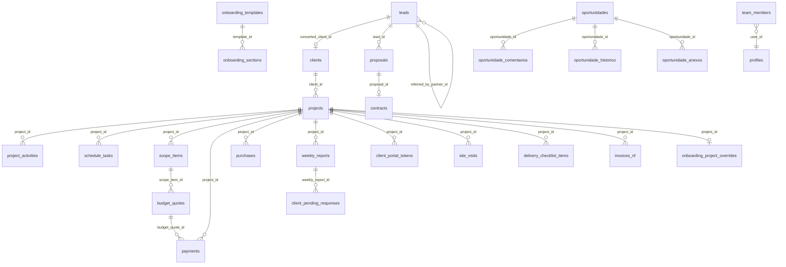

# Data model

Last verified: 2026-11-13, commit ece07d4 (branch fix/orcamentos-escopo-manual-fornecedor) plus uncommitted working tree.

Source of truth: `supabase/migrations/` (126 files, first `20260206155922_*.sql`, last `20261106120100_site_media_bucket.sql`). `src/integrations/supabase/types.ts` is generated and lags behind: it lacks `blog_posts`, `instagram_profiles`, `instagram_metrics` and newer columns (see [open-questions.md](open-questions.md)). All tables live in schema `public` and, with few exceptions, have RLS enabled.

## Entity groups

| Group | Tables |
|---|---|
| Identity and access | `profiles`, `user_roles`, `user_permissions`, `team_members`, `settings` |
| Commercial | `leads`, `lead_form_submissions`, `acquisition_channels`, `clients`, `proposals`, `proposal_templates`, `proposal_assets`, `proposal_blocks`, `contracts`, `contract_templates` |
| Projects | `projects`, `project_rooms`, `project_activities`, `schedule_tasks`, `schedule_scenarios`, `schedule_scenario_activities`, `activity_templates`, `activity_template_items`, `default_disciplines`, `discipline_priorities`, `delivery_checklist_items`, `client_closing_schedule`, `documents`, `plant_analyses` |
| Scope and budget | `scope_items`, `budget_quotes`, `budget_quote_items`, `budgets`, `budget_analysis_imports`, `budget_discipline_suppliers`, `scenarios`, `scenario_items`, `suppliers`, `supplier_scopes`, `supplier_allocations`, `purchases`, `material_calculations`, `material_tracking`, `material_indices`, `discipline_material_estimates`, `labor_costs`, `calculation_parameters`, `calculation_rules`, `price_research` |
| Tracking | `site_diary_entries`, `site_tracking`, `site_visits`, `weekly_reports`, `pending_items`, `reports` |
| Finance | `payments`, `invoices`, `invoices_nf` |
| Client portal | `client_portal_tokens`, `client_pending_responses`, `onboarding_templates`, `onboarding_sections`, `onboarding_project_overrides` |
| Tasks and AI | `voice_tasks`, `chat_conversations`, `chat_messages`, `message_templates`, `notifications` |
| Content | `content_posts`, `content_series`, `instagram_inspirations`, `instagram_profiles`, `instagram_metrics` |
| Public site | `site_content`, `blog_posts` |
| Buddy board | `oportunidades`, `oportunidade_comentarios`, `oportunidade_historico`, `oportunidade_votos`, `oportunidade_anexos`, `iaplicada_links` |

(77 tables in total across migrations.)

## Main relationships

Relationships come from column names in `types.ts` and migrations. Foreign key details were not exhaustively verified.

## Important fields

| Table | Fields worth knowing |
|---|---|
| `leads` | `status` (text, see BR-016), `lead_type` (`comercial`/`parceiro`), `partner_stage`, `referred_by_partner_id`, `channel_id`, `origin`, `source_detail`, `converted_client_id`, `converted_at`, `lost_reason`; `user_id` nullable since `20260630120000_site_leads_anon_insert.sql` |
| `clients` | `source_lead_id`, `converted_at`, address split fields, `client_type`, `origin` |
| `projects` | `status`, `sub_status`, `project_number`, `client_id`, budgets (`estimated_budget`, `ideal_budget`, `client_budget`, `real_budget`), dates, `client_move_in_date`, `cotacao_aprovada`, `cotacao_valor_total`, `cotacao_aprovada_at`, `cotacao_importada`, `source_proposal_id`, `onboarding_dismissed` |
| `project_activities` | `depends_on` (array of ids), `duration_days`, `start_date`, `end_date`, `discipline`, `area_m2`, `medicao_date`, `position`, `progress_percent`, `status` |
| `schedule_tasks` | Client-facing schedule: `is_client_visible`, `source_activity_id`, `dependencies`, `status` (`planejado`, `em_execucao`, `executado`, `atrasado`) |
| `scope_items` | `discipline`, `scope_type` (for example `contratado`), `status`, `estimated_value`, `payment_terms`; `note` column exists in migrations but not in `types.ts` |
| `budget_quotes` | `scope_item_id`, `activity_id`, `discipline`, `supplier_id`, `supplier_name`, `value`, `material_estimate`, `delivery_time`, `payment_terms`, `status`, `revision`, `revision_number`, `is_current_revision`; `valid_until` in migrations, not in `types.ts` |
| `budget_discipline_suppliers` | `project_id`, `discipline` (free text, unique with project), `supplier_id`, `user_id`. Responsible supplier per discipline/group in the Budget tab. Team RLS via `get_team_user_ids()`. Migration `20261113130000_budget_discipline_suppliers.sql`. |
| `payments` | `source` (`escritorio`/`obra`/`cotacao` used in code), `payment_type`, `status`, `installment_number`, `total_installments`, `due_date`, `paid_date`, `parent_payment_id`, `budget_quote_id` |
| `invoices_nf` | `nf_type` (`emitida` used in rules), `status`, `amount`, `competence_month`, `service_code`, recipient address fields, `sent_to_accountant_at` |
| `client_portal_tokens` | `token`, `is_active`, `expires_at`, `project_id`; unique index: one active token per project |
| `client_pending_responses` | `weekly_report_id`, `pending_item`, `status`, `response_text`, `client_name`; unique on (`weekly_report_id`, `pending_item`) |
| `team_members` | `team_id`, `user_id`, `role` |
| `user_permissions` | `user_id`, `page_key`, `can_view`, `can_edit` |
| `settings` | `tax_rate_percent` (default 6), `nf_service_code`, `purchase_categories`, `supplier_categories`, `message_templates`, `calculation_params`, `cost_per_sqm`, `scope`, `theme` |
| `site_content` | `team_id`, `key`, `type`, `value_json` |
| `blog_posts` | `team_id`, `slug`, `title`, `content` (Markdown), `status` (`draft`/`published`), `published_at`, `category`, `author` |
| `oportunidades` | `numero` (`OPT-XXXX`), `tipo`, `status`, `prioridade`, `impacto`, `aprovado_autor_em`, `data_prevista` |

## Enums

| Enum | Values |
|---|---|
| `app_role` | `admin`, `moderator`, `user` |
| `client_type` | `residencial`, `comercial`, `saude`, `outro` |
| `client_origin` | `indicacao`, `instagram`, `google`, `site`, `outro` |
| `budget_status` | `pendente`, `cotado`, `aprovado`, `rejeitado` |
| `purchase_status` | `pendente`, `comprado`, `entregue`, `instalado` |
| `payment_status` | `pendente`, `notificado`, `pago`, `atrasado` |
| `document_category` | `planta`, `contrato`, `laudo`, `proposta`, `relatorio`, `orcamento` |
| `tracking_type` | `checkin`, `voz`, `foto`, `nota` |
| `lead_type` | `comercial`, `parceiro` |
| `partner_stage` | `novo`, `primeira_conversa`, `parceria_ativa`, `trouxe_indicacao`, `fidelizado`, `inativo` |
| `project_status` | `proposta`, `contrato`, `projeto`, `planejamento`, `mobilizacao`, `execucao`, `concluido` |
| `acquisition_channel_category` | `digital`, `indicacao`, `evento`, `parceria`, `outros` |

Other status sets are enforced by CHECK or triggers (activities, pending responses, content posts, blog posts, oportunidades). See the business rules.

## Functions and triggers

| Name | Kind | Purpose |
|---|---|---|
| `has_role(uuid, app_role)` | function | Role check used by RLS and edge functions |
| `is_admin()`, `has_acesso(text)` | function | Buddy board helpers (`20260915163213_buddy_oportunidades.sql`) |
| `get_team_user_ids()`, `get_my_team_id()`, `get_my_team_ids()` | functions | Team scoping for RLS |
| `handle_new_user` | trigger on `auth.users` | Creates `profiles` row |
| `update_updated_at_column` | trigger function | Maintains `updated_at` |
| `check_scope_status_irreversible` | trigger on `scope_items` | BR-062 |
| `validate_project_activity`, `validate_pending_response_status`, `validate_supplier_allocation_rating`, `validate_content_post`, `validate_lead_referral` | triggers | Validation |
| `notify_new_lead` | trigger on `lead_form_submissions` | Notifies admins |
| `notify_client_portal_change` | trigger on 14 tables | Realtime broadcast for the portal |
| `rotate_client_portal_token(uuid)` | RPC | Replace the active portal token (granted to `authenticated`) |
| `get_public_site_content(uuid)`, `get_public_blog_posts(uuid)`, `get_public_blog_post(uuid, text)` | RPC, granted to `anon` | Public site reads |
| `stamp_site_content`, `stamp_blog_post` | triggers | Timestamps and publish date |
| `oportunidades_*`, `recusar_entrega_oportunidade` | triggers and RPC | Buddy board rules |

`pg_cron` and `pg_net` extensions are enabled by `20260319205031_*.sql`. No `cron.schedule` call exists in the migrations.

## Row Level Security (summary)

- Initial policies were per user (`auth.uid() = user_id`). From `20260327175547_*.sql` most tables use team policies: read, update and delete when `user_id IN (SELECT get_team_user_ids())`; insert when `auth.uid() = user_id`.
- Exceptions with open access: `lead_form_submissions` (anyone can insert), `leads` (anon insert for site origin), `client_pending_responses` (anon insert and update with `true`), `default_disciplines`, `calculation_parameters`, `labor_costs` and some Buddy tables (any authenticated user can read).
- Public RPCs: site content and blog (BR-137, BR-141).

## Storage buckets

| Bucket | Public | Used by |
|---|---|---|
| `project-files` | yes | Plants and project documents (`ProjectDocumentsTab`, `GenerateActivitiesDialog`, `ImportPlantDialog`) |
| `proposal-assets` | yes | Proposal and contract images (`useProposalAssets`) |
| `invoices` | yes | NF files (`InvoiceNFForm`) |
| `onboarding-media` | yes | Onboarding images and videos |
| `site-media` | yes | Public site images (`useSiteContent`) |
| `oportunidade-anexos` | no (private) | Buddy attachments (`oportunidades.functions.ts`) |

The `invoices` bucket is public, which exposes fiscal documents to anyone with the URL (see [open-questions.md](open-questions.md)).

## Migrations

- Naming: `<timestamp>_<uuid>.sql` (generated by Lovable) until mid 2026, then descriptive names (for example `20261104120000_payments_cotacao_unique_installments.sql`).
- Counts per month: 2026-02: 17, 03: 47, 04: 20, 06: 14, 07: 1, 08: 9, 09: 8, 10: 7, 11: 3.
- Some migrations are defensive (`IF NOT EXISTS`, `to_regclass` checks) because they were ported from another IAplicada project (see header of `20260915163213_buddy_oportunidades.sql`).
- Application of migrations to production is not scripted here.
