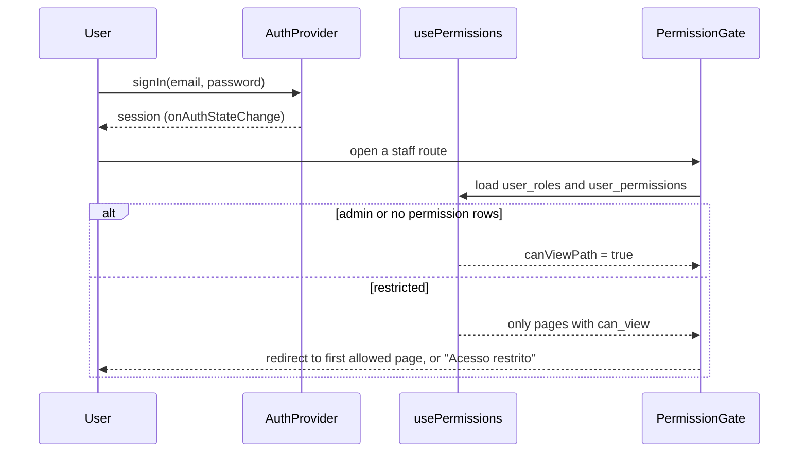
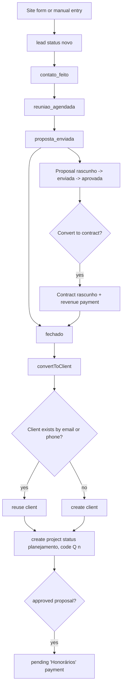
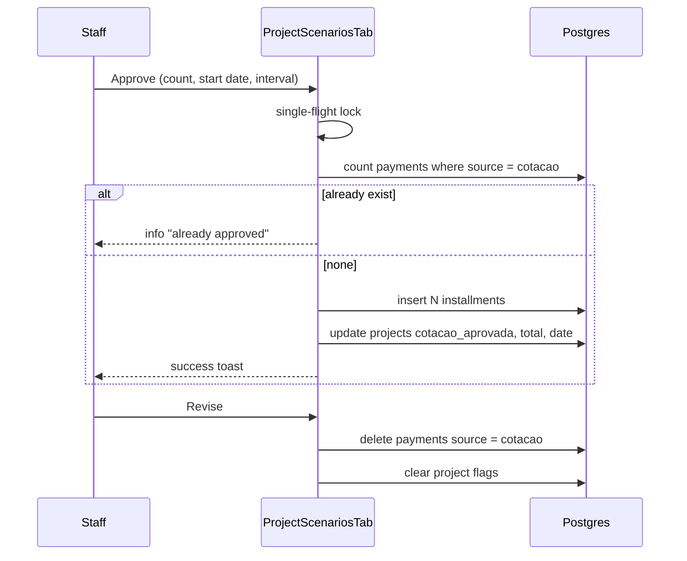
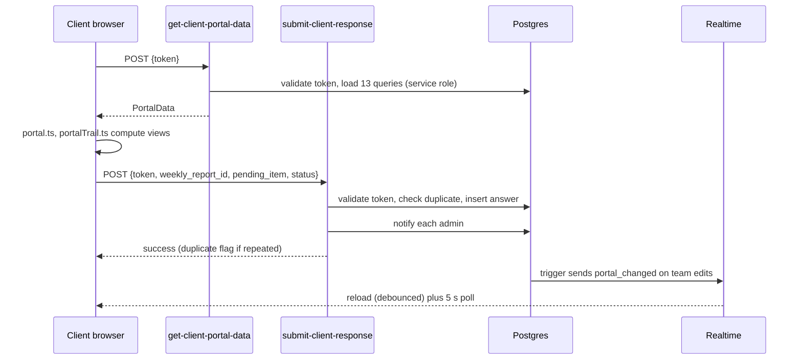
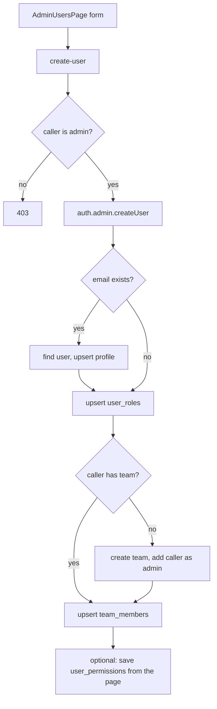

# Logic flows

Last verified: 2026-11-13, commit d629e0b (branch feat/sync-5s-aprovacao-cenarios-cliente) plus uncommitted working tree.

## 1. Sign-in and screen access



Rules: BR-001 to BR-006. Files: `src/App.tsx`, `src/contexts/AuthContext.tsx`, `src/hooks/usePermissions.ts`, `src/components/layout/PermissionGate.tsx`.

## 2. Lead to client to project



Rules: BR-016 to BR-019, BR-031 to BR-033, BR-040. Files: `src/pages/LeadsPipeline.tsx`, `src/hooks/useLeads.ts` (`convertToClient`), `src/pages/LeadDetail.tsx`, `src/pages/LeadsProposals.tsx`.

## 3. Scope to schedule (AI assisted)

```mermaid
flowchart TD
  IN[Text, audio transcript or plant file] --> GA[generate-activities / analyze-plant]
  GA --> PREV[Preview dialog in GenerateActivitiesDialog]
  PREV --> SAVE[Insert project_activities with depends_on]
  SAVE --> TL[ApplyCalendarDialog and schedule scenarios: buildTimeline in business days]
  SAVE --> CASC[Edit dates: applyReverseEdit, computeCascade]
  SAVE --> CPM[computeCriticalPath]
  SAVE --> CK[ProjectScheduleTab: generate-checkpoints -> site_visits]
  SAVE --> PRE[ActivityForm: createPrerequisiteTasks -> voice_tasks (inferred table)]
```

Rules: BR-043 to BR-052, BR-057 to BR-061, BR-126, BR-128. Files: `src/components/projects/GenerateActivitiesDialog.tsx`, `src/lib/businessCalendar.ts`, `src/lib/reverseSchedule.ts`, `src/lib/prerequisiteTasks.ts`, `src/hooks/useProjectActivities.ts`.

## 4. Quote approval to payments



Rules: BR-070, BR-081, BR-082. Files: `src/components/projects/ProjectScenariosTab.tsx`, `src/lib/cotacaoInstallments.ts`.

## 5. Client portal read and answer



Rules: BR-093 to BR-102. Files: `supabase/functions/get-client-portal-data/index.ts`, `supabase/functions/submit-client-response/index.ts`, `src/hooks/useLivePortalData.ts`, `src/pages/ClientPortal.tsx`.

## 6. Create a user (admin)



Rules: BR-007 to BR-009. Files: `src/pages/AdminUsersPage.tsx`, `supabase/functions/create-user/index.ts`.

## 7. Weekly report to client

1. Staff opens the tracking tab (`src/components/projects/ProjectTrackingTab.tsx`).
2. "Generate summary with AI" builds context with `buildWeeklyAIContext` and calls `project-ai-assistant` (`weekly_summary`).
3. The answer goes through `normalizeAISummary` into the form fields.
4. The report is saved in `weekly_reports`; `client_pending` lines become items the client answers in the portal.
5. The text is shared by WhatsApp (`buildWeeklyReportMessage`, `whatsappPhone`) or exported as PDF (`src/lib/generateWeeklyReportPdf.ts`).

Rules: BR-072 to BR-074.

## 8. Notification sweep

```mermaid
flowchart LR
  T[Caller or scheduler (not in repo)] --> F[check-notifications]
  F --> R1[8 rules query tables]
  R1 --> D{notification of same type<br/>in last 3 days?}
  D -- no --> N[insert notifications]
  N --> V[some rules also insert voice_tasks]
  N --> RT[Realtime INSERT -> bell in header]
```

Rules: BR-115 to BR-124. Files: `supabase/functions/check-notifications/index.ts`, `src/hooks/useNotifications.ts`.

## 9. Buddy card delivery

1. A card moves to `entregue` (admin only).
2. The author sees the approval reminder (BR-157) and approves, or refuses with a reason through `recusar_entrega_oportunidade`.
3. Refusal returns the card to `em_analise` and writes history.

Rules: BR-148 to BR-157. Files: `src/pages/BuddyBug.tsx`, `src/lib/oportunidades.functions.ts`.
